# Headroom

Headroom shows your remaining AI subscription quotas on Android. It supports Claude, ChatGPT Codex,
GitHub Copilot, Grok, Z.AI, Kimi Code, OpenCode Go, JetBrains AI, Muse and Gemini.
Home screen and lock screen widgets show your usage. Reset alerts tell you when a weekly limit resets.

Headroom is free software under the [Apache License 2.0](LICENSE).

<p align="center">
  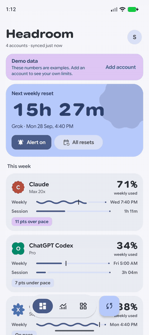
</p>

The recording is also available as a [video](docs/media/demo.mp4). It shows demo data.

> [!IMPORTANT]
> Headroom reads usage from undocumented endpoints. It signs in with the OAuth clients used by
> each provider's command-line tools. Providers can change or block access at any time.
> Their terms may prohibit this access. Headroom targets personal use and sideloading.
> Headroom has no affiliation with these providers.

## Screenshots

| Overview | Account detail | Resets | Stats |
|---|---|---|---|
| 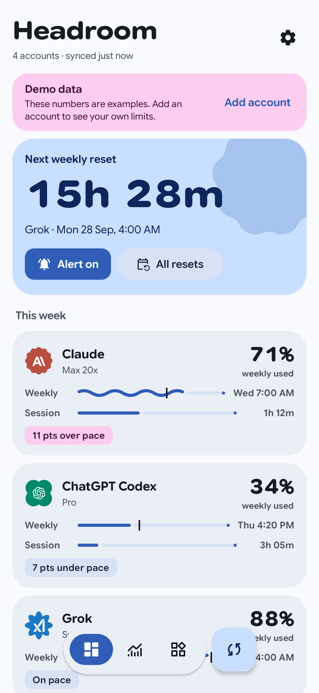 | 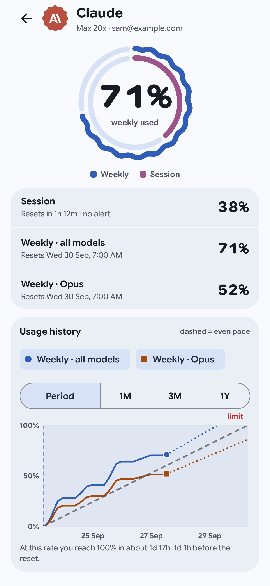 | 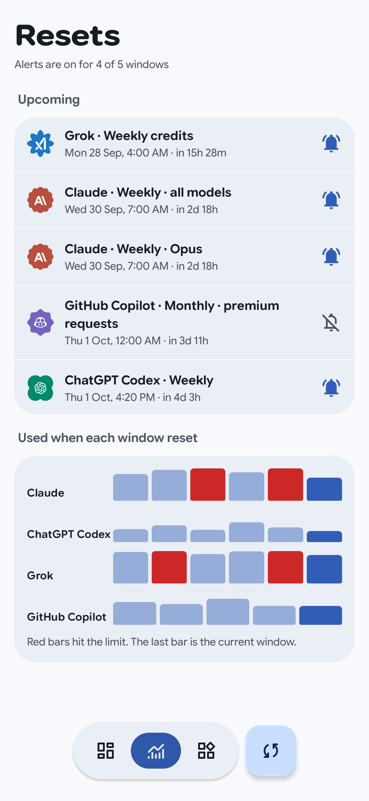 | 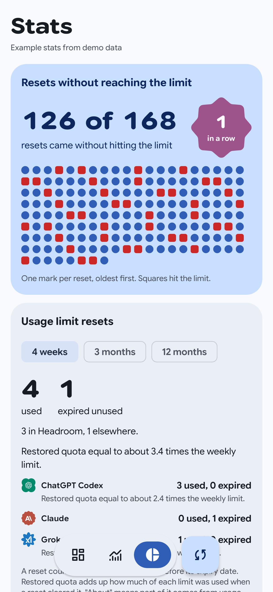 |

| Dark theme | Accounts | Sign-in with a device code |
|---|---|---|
| 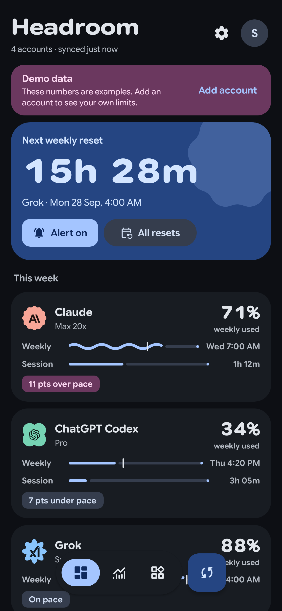 | 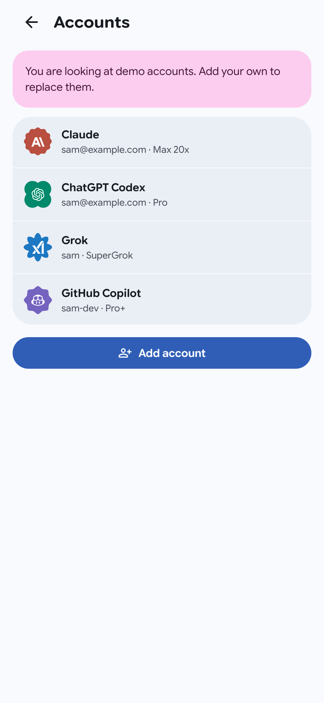 | 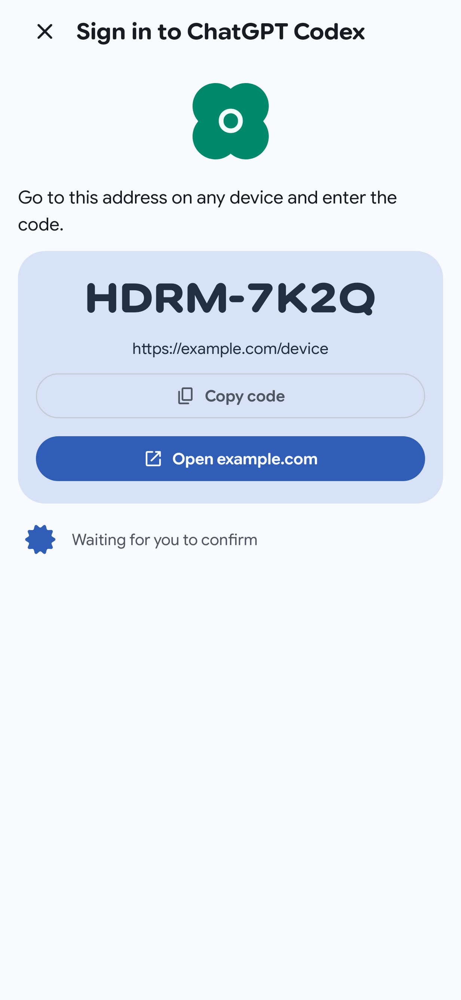 |

| Settings | A colour palette | Refresh shimmer | Reset confetti |
|---|---|---|---|
| 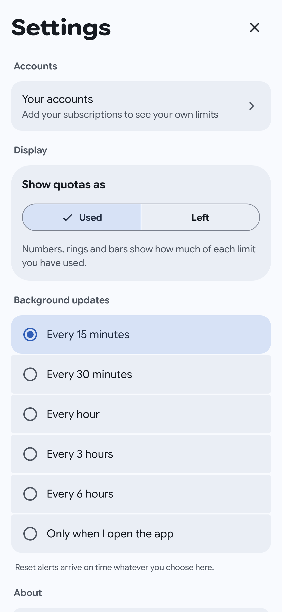 | 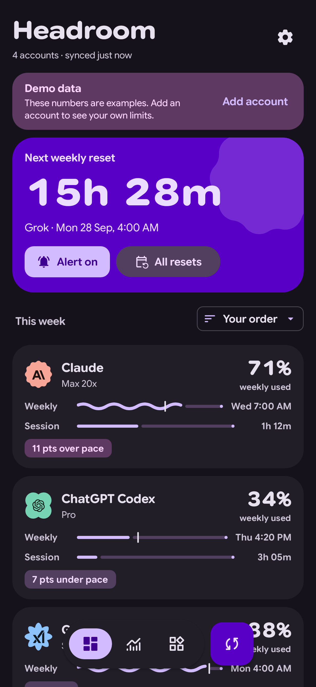 | 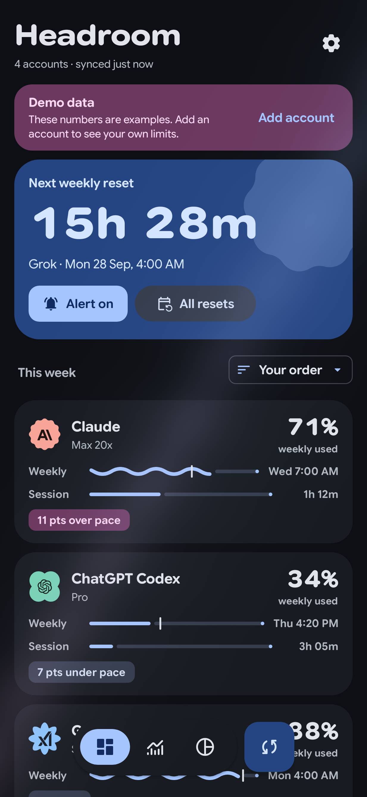 | 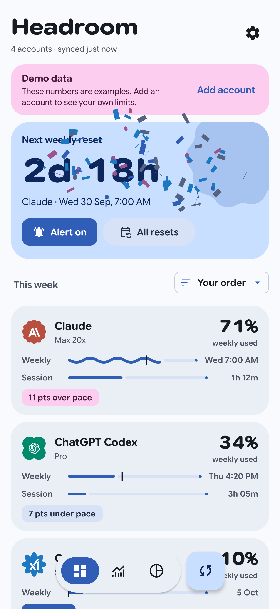 |

The experimental reset island expands from the camera cutout when a limit resets while Headroom runs
in the background. It shows the provider logo and a ring that refills.
A letter identifies the account when you have several accounts with that provider:


Tablets and unfolded foldables show the account list beside the selected account's details:

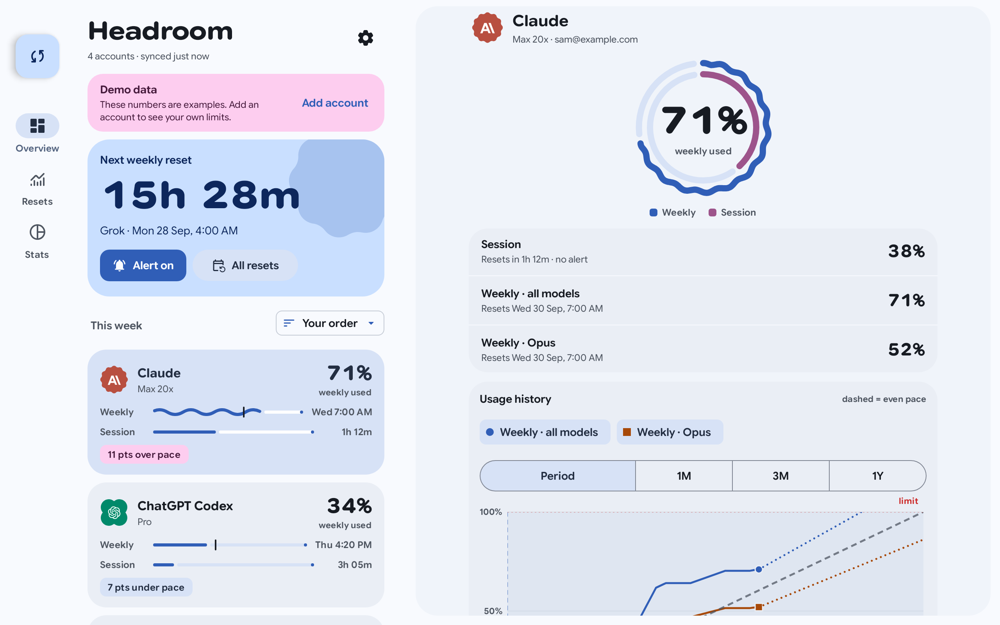

When a sign-in expires, Headroom fades the account's last usage values and shows their age.
The account offers a sign-in button. Headroom posts one warning notification and removes it after a successful sync:

| Overview | Account detail | Widget | Notification |
|---|---|---|---|
| 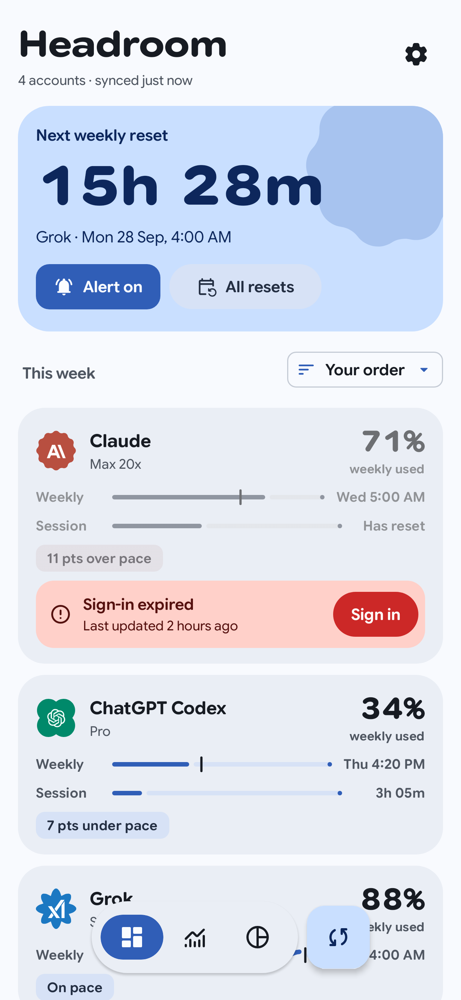 | 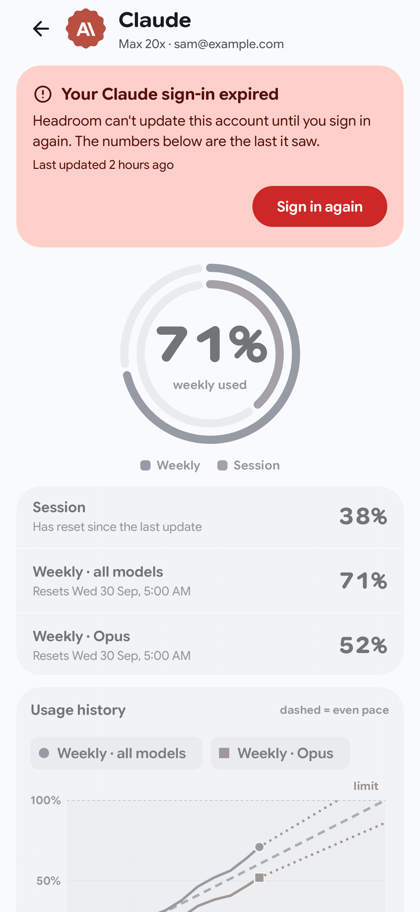 | 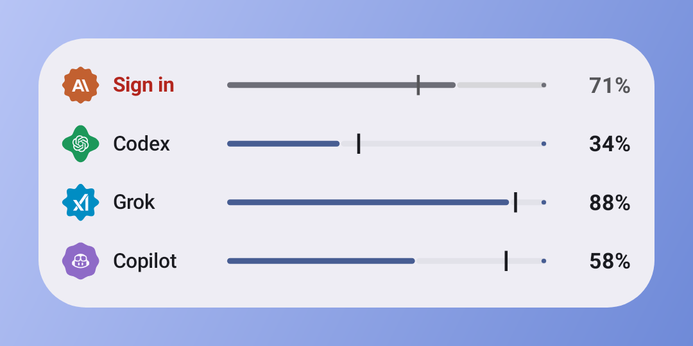 | 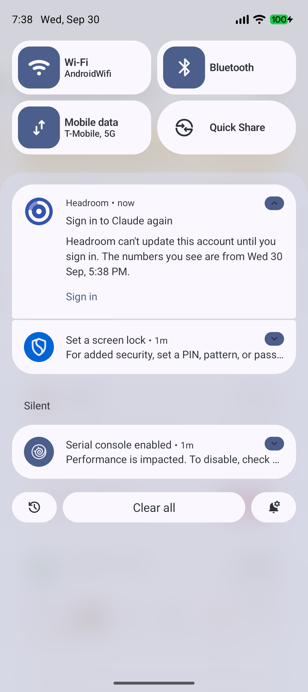 |

### Widgets

Every widget is a Remote Compose document drawn by the launcher, so the widgets need Android 16 or
later, the first version with a widget player. The pictures below come from that player.

| Rings, one account | Rings, several accounts | Shape |
|---|---|---|
| 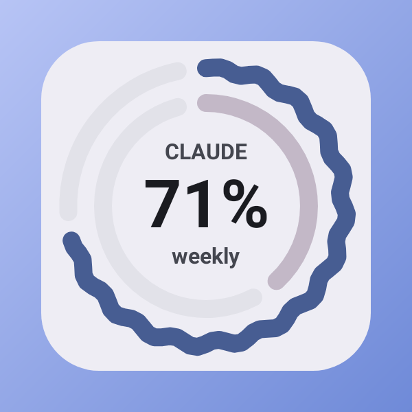 | 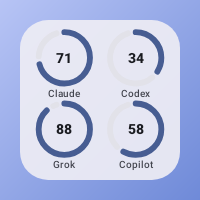 | 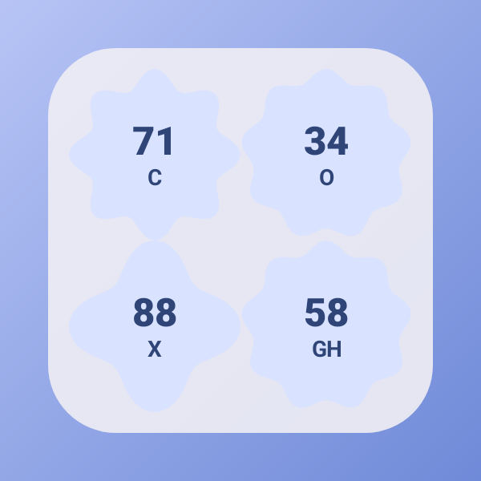 |

| Bars | Lock screen |
|---|---|
| 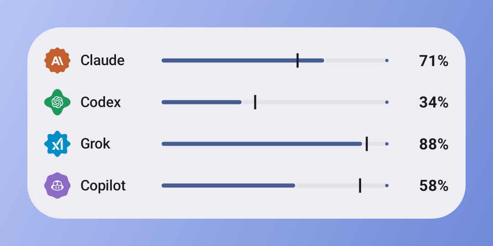 | 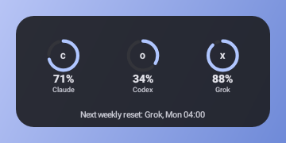 |

## Features

- The overview shows each account's weekly or monthly usage, session usage, and difference from an even usage rate.
- A tick on each bar shows an even usage rate. The detail screen plots all of an account's weekly and monthly windows together over time (up to a year of history when "Keep long-term history" is on), marks past resets, shades the primary window's current period with its even-pace line and projection, and supports pan, pinch-zoom, scrubbing tooltips, window filter chips and Period / 1M / 3M / 1Y range presets.
- Bars become wavy when the account exceeds an even usage rate or 85% usage. Other bars stay flat.
- Expired sign-ins keep their last values, history, names and alerts. Headroom shows the values' age and offers sign-in again.
  Expired accounts cannot supply the next reset or trigger reset alerts.
- Provider-issued resets refill limits early. Headroom lists each reset and its expiry date.
  The Codex and Grok confirmation sheet refills the bars after a successful reset and shows the remaining reset count.
  Enable "Redeem Claude resets (experimental)" in Settings to use Claude resets.
  This setting defaults to off. Nobody has tested Claude redemption with a real account.
  See [Usage-limit resets](docs/RESETS.md) for provider support, including Z.AI.
- One-time credits show usage and expiry dates, including Claude's cloud session credit.
  Headroom also displays unfamiliar quotas and labels them as unrecognised.
- The Quick Settings tile opens Headroom and shows the next reset or the quota nearest its limit.
- Headroom schedules an alarm for each weekly window. It fetches usage when the alarm fires and posts a heads-up notification after confirming the reset.
  Session and daily limits never trigger alerts. Monthly alerts require opt-in.
  Each alert has a bell switch in the Resets tab.
- Reset reminders arrive about a day before an available reset expires, with at most one reminder daily.
  For example, a reminder says "Your ChatGPT Codex reset expires tomorrow at 06:18".
  Tapping it opens the account's resets. Settings can disable reminders.
- Home screen and lock screen widgets offer Rings, Bars, Shape and Countdown styles.
  Each widget saves its accounts, window and colours. Settings can add any style to the home screen.
- Stats uses history stored on the device. It shows reset cycles completed without reaching a limit and each provider's share of quota usage.
  It also shows usage by hour, maximum usage, unused quota at reset, and a seven-day line for each account.
- Drag accounts to set their order, or sort them by usage or next reset.
- Settings controls used or remaining values, background update frequency, and light, dark or device theme.
  Colours follow your wallpaper or one of eight palettes. Theme transitions expand from the tap location.
  Reduced motion replaces moving transitions with short fades.
- Optional effects include a rainbow shimmer with sparkles after updates and confetti after a reset while the app is open.
  Each effect has a Try button and an off switch.
- The experimental reset island uses an accessibility service that reads no screen content.
  Devices that block that service can use the Display over other apps permission. Settings explains each setup path.
- Phones use a floating toolbar. Foldables and tablets use a navigation rail. Wide screens show the list beside account details.
- With no signed-in account, Headroom displays labelled demo data.

## Signing in

Headroom follows each provider's own sign-in flow.
It encrypts tokens with an Android Keystore key and excludes them from backups.

| Provider | How you sign in |
|---|---|
| Claude | Browser sign-in. The page returns to the app; if it cannot, paste the code the page shows. |
| ChatGPT Codex, Grok, JetBrains AI | Browser sign-in, returning to the app. |
| GitHub Copilot, Kimi Code, Muse | Device code: enter a short code on the provider's page. |
| Z.AI, OpenCode Go | API key. |

## Installing

Download the APK from the [latest release](https://github.com/rock3r/headroom/releases/latest) and
open it on your phone. Headroom needs Android 14 or later, and its widgets Android 16 or later.
Releases are signed with the same key every time, so later releases install over earlier ones. [docs/RELEASING.md](docs/RELEASING.md)
explains how a release is made.

### With Obtainium

[Obtainium](https://obtainium.imranr.dev/) installs Headroom from GitHub releases and reports available updates.

[](https://apps.obtainium.imranr.dev/redirect?r=obtainium://app/%7B%22id%22%3A%22dev.sebastiano.headroom%22%2C%22url%22%3A%22https%3A%2F%2Fgithub.com%2Frock3r%2Fheadroom%22%2C%22author%22%3A%22rock3r%22%2C%22name%22%3A%22Headroom%22%7D)

The badge opens apps.obtainium.imranr.dev. That site offers Obtainium installation when the app is missing.
If you have Obtainium, you can add Headroom with this URL:

```
https://github.com/rock3r/headroom
```

The APK signing certificate has this SHA-256 fingerprint:

```
81:5F:AA:26:1D:76:B2:B3:37:E4:AB:D0:F3:BA:31:84:AD:05:FB:8E:BD:65:01:42:43:47:22:69:BC:DA:5F:C2
```

## Building

Install JDK 21 and Android SDK platform 37 before building.

```bash
./gradlew :app:installDebug
```

The app needs Android 14 (API 34) or later. The widgets need Android 16 (API 36) or later.

## Project layout

| Module | What it holds |
|---|---|
| `:core:model` | Quota types, pace maths, reset rules, repository contracts, demo data |
| `:core:quota` | One fetcher per provider |
| `:core:auth` | Sign-in flows, token refresh, token store contract |
| `:core:data` | Room history, sync, reset alarms, notifications, encrypted tokens |
| `:core:designsystem` | Theme, type, quota indicators, provider avatars |
| `:third-party:compose-charts` | Vendored `compose-charts` library for the detail usage history chart |
| `:widget` | Remote Compose widgets |
| `:app` | Screens, navigation, adaptive layouts, wiring |

[docs/ARCHITECTURE.md](docs/ARCHITECTURE.md) describes the modules and their data flow.

## Tests and quality checks

Contributors write tests before production code. `./gradlew check` must pass with zero findings.
The task runs these checks:

- the unit tests, including Robolectric and Compose UI tests;
- detekt, with Nacho Lopez's Compose Rules;
- ktfmt in KotlinLang style;
- Android Lint, with every warning treated as an error.

| Command | What it does |
|---|---|
| `./gradlew check` | Everything above. This is the gate for every commit and for CI. |
| `./gradlew :app:pixel9api37DebugAndroidTest` | End-to-end tests on a Gradle-managed Pixel 9 emulator with API 37, using demo data. |
| `./gradlew :app:recordRoborazziDebug` | Records the app screenshots in `docs/screenshots/`. |
| `./gradlew :widget:recordWidgetGallery` | Records the widget pictures in `docs/screenshots/widgets/`. |
| `./gradlew ktfmtFormat` | Formats the code. |

GitHub Actions runs `check` for pull requests and `main`.
The path filter skips tests, including end-to-end tests, for documentation-only changes
([.github/workflows/ci.yml](.github/workflows/ci.yml)).

The contributor guides cover [testing](docs/TESTING.md), [static analysis](docs/STATIC-ANALYSIS.md)
and [conventions](docs/CONVENTIONS.md).

## Known limitations

- Real-account testing covers one Pixel phone. Automated tests use recorded responses and a local test server.
  Provider response changes can break a fetcher without failing those tests.
- Codex and Grok resets follow the providers' clients. Codex redemption passed a real-account check; Grok redemption remains untested with real accounts.
  [RESETS.md](docs/RESETS.md) records those checks. Use `adb logcat -s HeadroomResets` to inspect requests without tokens or account details.
- Remote Compose remains alpha. Widgets pin one library version and use restricted APIs for live countdowns.
- Widget checks use the Android 16 widget player under Robolectric. Device-launcher checks remain incomplete.
  Lock screen widgets and the tap-to-flip ring have no hardware test results.
- Android can stop Headroom during browser sign-in and cancel the flow. Restart sign-in if that happens.
- Some work profiles and device policies block the reset island's accessibility service.
  The Display over other apps fallback works on those devices.
  Status bar icons draw above that overlay, and the overlay cannot appear on the lock screen.

## Credits

Most provider logos come from [models.dev](https://models.dev)
([sst/models.dev](https://github.com/sst/models.dev), MIT licence).
The JetBrains logo comes from [Simple Icons](https://simpleicons.org) (CC0), with adaptations.
The logos remain their owners' trademarks. Headroom uses them to identify account providers.

## Licence

Copyright 2026 Sebastiano Poggi.

Headroom uses the Apache License, Version 2.0. [LICENSE](LICENSE) contains the full terms.
Provider logos have separate terms, listed in Credits.
